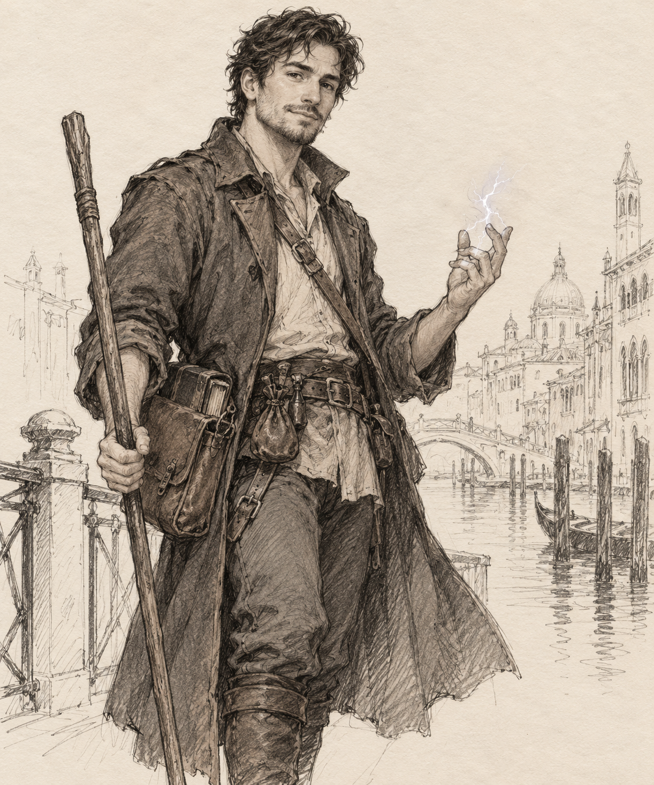

# Nimras — Rank 2 Magic-User

Approved appearance reference, generated with the built-in image tool. Quarterstaff already included in equipment.

Historical creation record; live game state is held in TypeDB. Freelance mage hunter; human, Civilized culture. Left his independent fellowship amicably. The current commission is to recover his former teacher Rennic Vaur and an entrusted manuscript in Purewater.

**Characteristics:** STR 11, CON 15, SIZ 10, DEX 12, INT 14, POW 15, CHA 15

**Resources:** 3 Action Points; 15 Magic Points; 5 Luck; initiative 13; movement 20 feet; damage modifier +0.

**Hit points:** head/legs 6; arms 5; abdomen 7; chest 8. No worn armour.

## Skills

| Skill | Base | Culture | Class | Experienced bonus | Total |
|---|---:|---:|---:|---:|---:|
| Athletics | 23 | 0 | 0 | 12 | 35 |
| Boating | 26 | 0 | 0 | 0 | 26 |
| Brawn | 21 | 0 | 0 | 0 | 21 |
| Conceal | 27 | 5 | 0 | 0 | 32 |
| Customs (Home culture) | 68 | 0 | 0 | 0 | 68 |
| Dance | 27 | 0 | 0 | 0 | 27 |
| Deceit | 29 | 10 | 0 | 21 | 60 |
| Drive | 27 | 5 | 0 | 0 | 32 |
| Endurance | 30 | 0 | 0 | 10 | 40 |
| Evade | 24 | 0 | 15 | 30 | 69 |
| First Aid | 26 | 0 | 0 | 0 | 26 |
| Influence | 30 | 10 | 10 | 20 | 70 |
| Insight | 29 | 15 | 15 | 11 | 70 |
| Locale (Home region) | 28 | 10 | 0 | 2 | 40 |
| Perception | 29 | 0 | 15 | 26 | 70 |
| Ride | 27 | 0 | 0 | 0 | 27 |
| Sing | 30 | 0 | 0 | 0 | 30 |
| Stealth | 26 | 0 | 0 | 30 | 56 |
| Swim | 26 | 0 | 0 | 0 | 26 |
| Unarmed | 23 | 0 | 0 | 0 | 23 |
| Willpower | 30 | 15 | 15 | 10 | 70 |
| Language (Common) | 69 | 0 | 0 | 0 | 69 |
| Commerce | 29 | 5 | 0 | 0 | 34 |
| Courtesy | 29 | 10 | 0 | 0 | 39 |
| Streetwise | 30 | 15 | 0 | 25 | 70 |
| Arcane Casting | 29 | 0 | 15 | 26 | 70 |
| Arcane Knowledge | 28 | 0 | 15 | 27 | 70 |
| Language (Elven) | 29 | 0 | 0 | 0 | 29 |
| Lore (Magical traditions) | 28 | 0 | 0 | 0 | 28 |
| Lore (Dangerous creatures) | 28 | 0 | 0 | 0 | 28 |
| Survival | 30 | 0 | 0 | 30 | 60 |
| Combat Skill (Mage) | 23 | 0 | 0 | 20 | 43 |

Pools: 100 culture, 100 class, 300 experienced bonus. Six class skills reach 70% or more. Survival is the extra Professional skill; Navigation and Track remain untrained.

## Ability

**Mental Strength:** once daily, resist mental magic with Willpower two grades easier; disbelieve illusions one grade easier. Free qualifying Rank 1 ability. Other paid Rank abilities are not awarded.

## Spellbook and preparation

**Rank 0 known:** Read Magic, Appraise, Avert, Befuddle, Chill, Cleanse, Coordination, Deflect, Dry, Ignite, Magic Tricks, Might, Protection, Repair, Preserve.

**Rank 0 prepared (5/5):** Read Magic, Avert, Protection, Coordination, Repair.

**Rank 1 known:** Magic Missile, Shield, Invisibility, Detect Magic, Sleep, Change Appearance, Web.

**Rank 1 prepared (5/5):** Magic Missile, Shield, Detect Magic, Invisibility, Change Appearance.

**Rank 2 known:** Dispel Magic, Lightning Bolt, Locate Object.

**Rank 2 prepared (3/3):** Dispel Magic, Lightning Bolt, Locate Object.

The book contains 15 cantrips, 7 Rank 1 spells and 3 Rank 2 spells. Casting does not consume a prepared spell. Spell preparation is a draft loadout; it can be changed through normal rest and study. Rank 2 cost reductions apply to lower-rank spells, with a 1 MP minimum.

Lightning Bolt provides force; Dispel Magic supports counterspelling; Locate Object supports pursuit subject to the spell’s actual conditions. Sleep and Web offer capture options. No automatic immunity, detection or target location is granted.

## Equipment and money

Quarterstaff, three darts, ordinary clothes, spellbook, component pouch, backpack, waterskin, seven days of rations, bedroll, sack, fire-lighting kit, candles, writing materials, belt pouch and 30 feet of rope.

Starting wealth: official engine 3d6 roll [5, 1, 1] = 7 GP. Rope costs 1 GP; remaining purse 6 GP. No unspecified contract advance added.

## Choices still belonging to the player

**Alignment: True Neutral (Pragmatic; freedom of action) 59%.** Nimras tries to be pleasant and amiable, holds firm personal boundaries, and is willing to kill when he judges it necessary. The player decides when that threshold is met. Confirmed personal passions: **Uphold my independence 70%; Loyalty to the fellowship 59%; Respect Rennic Vaur 50%.**

The fellowship’s name, home region, age and appearance are open. Civilized upbringing and Elven reading are draft choices. Customs and Locale concern his home, not Purewater. No starting scene has been played.

## Rules used

CFI SRD: Characters steps 4–8 and experienced-character table; Civilized human culture; Magic-User class, rank table, abilities and spell list; Magic, spell learning and memorisation; equipment tables. Actual rolls use the Mythras CLI.

Saved as a creation draft in the existing Purewater database at d6/dusk. Halla, the campaign scene and world clock are unchanged.

Creation revision: Stealth 56%, Deceit 60%. No extra skill points granted. Rank 2 prerequisites, spellbook, resources and weapon skill preserved.

Creation revision: Invisibility and Change Appearance replace Armor and Feather Fall. Both new spells are prepared; Sleep and Web remain in the spellbook and may be prepared through normal rest and study.

## Current moral code — player clarification, 24 October 2026

Nimras values freedom from imposed constraints and rules. He regards much of
Thornmere's orthodox legality as corrupt and has no objection to breaking its
laws. Theft, heists, smuggling and illicit deals can be entrepreneurial work to
him; an official description of someone as a criminal does not settle his moral
judgement.

He distinguishes willing participants “in the game” from ordinary people, and
tries to keep ordinary people safe. He will not victimise the helpless or treat
bystanders as expendable. Participation in the trade is not blanket permission
for cruelty. His established willingness to use necessary force against dangerous
opposition remains subject to the player's decision; do not turn this code into
mandatory pacifism or a licence to harm every employee or coerced participant.

Use this clarification over earlier shorthand about pragmatism. No alignment
label, Passion value or skill changes automatically. No NPC learns these private
convictions without an actual disclosure or observed conduct.

Current after Glass Hounds: Arcane Casting71%, Stealth57%, purse13GP4SP; both
awarded experience rolls spent. This creation record's earlier resource totals
and unplayed-start statements are historical, not a reset of the live save.
